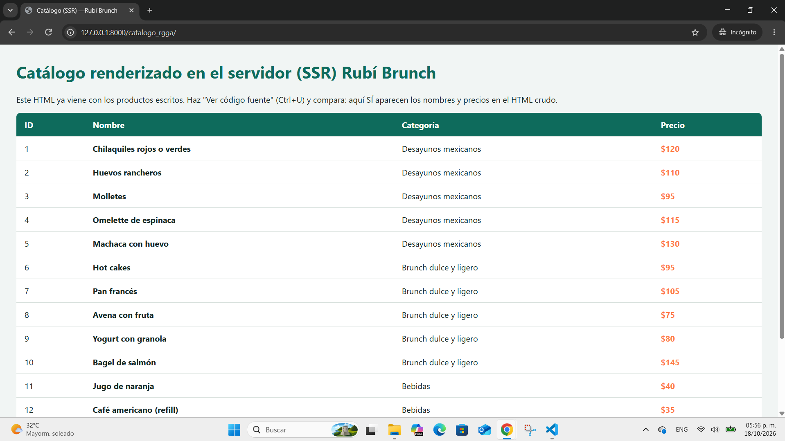
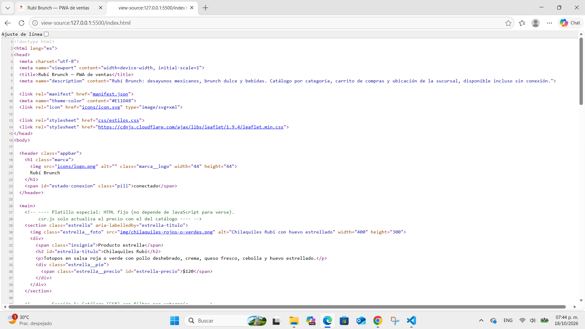
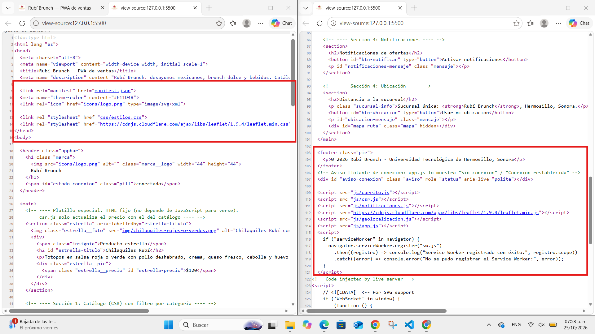
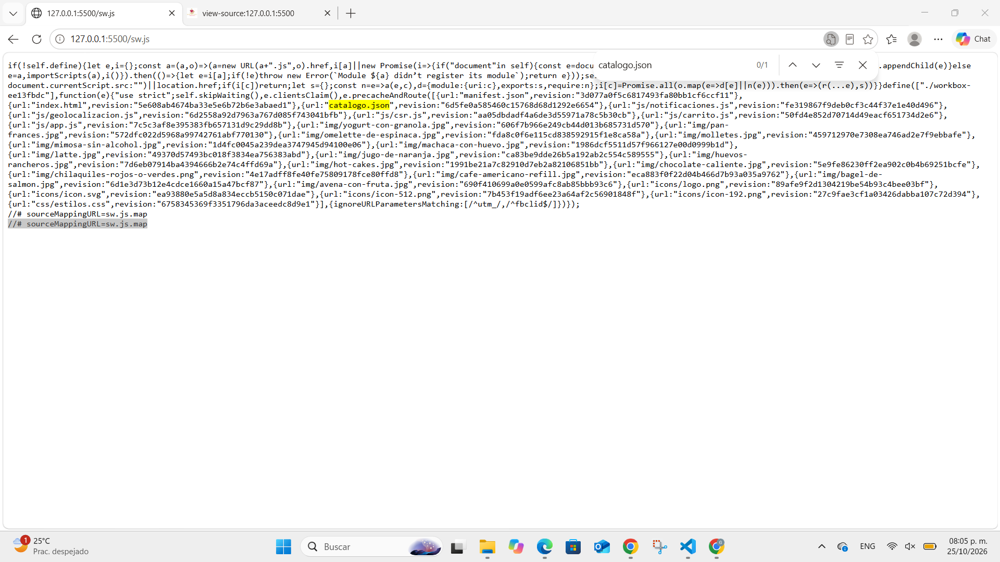

# Rubí Brunch — PWA de ventas

| Dato | Valor |
|---|---|
| **Alumno** | RUBI GARCIA GISEL ALINNE |
| **Grupo** | ING10-1 |
| **Negocio · giro** | Rubí Brunch · Desayunos y brunch · Restaurante de desayunos y brunch: platillos mexicanos de mañana, opciones dulces y bebidas, hasta las 2 de la tarde. |
| **URL del repositorio** | https://github.com/RubiGarciaGiselAlinne/Rubi-Brunch-pwa_rubi-garcia-gisel-alinne |
| **URL de GitHub Pages** | https://rubigarciagiselalinne.github.io/Rubi-Brunch-pwa_rubi-garcia-gisel-alinne/ |

## Historial de avances

| Avance | Hash del commit entregado | Fecha |
|---|---|---|
| 1 | 3b7528b | 11/10/2026 |
| 2 | 648658a | 18/10/2026 |
| 3 | (hash del avance 3) | 25/10/2026 |
| 4 | (se escribe en el reporte PDF) | 01/11/2026 |

## Comparación SSR vs CSR

### SSR (Django): los productos llegan escritos en el HTML

### CSR (JavaScript): el div del catálogo llega vacío

## Funciones PWA (avance 3)

### index.html: manifest y registro del Service Worker activos

### sw.js: Workbox precachea el catálogo y las fotos

