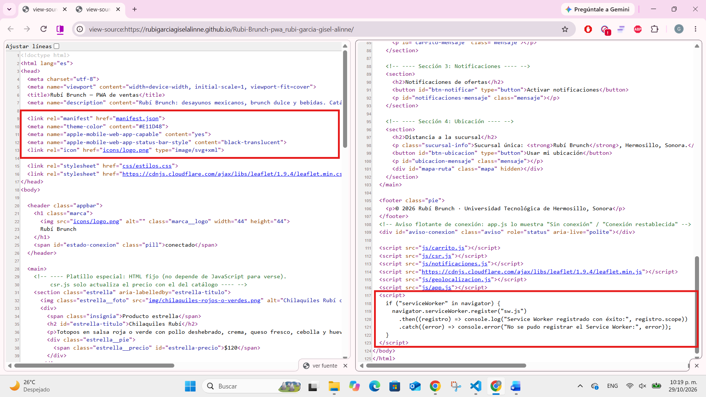
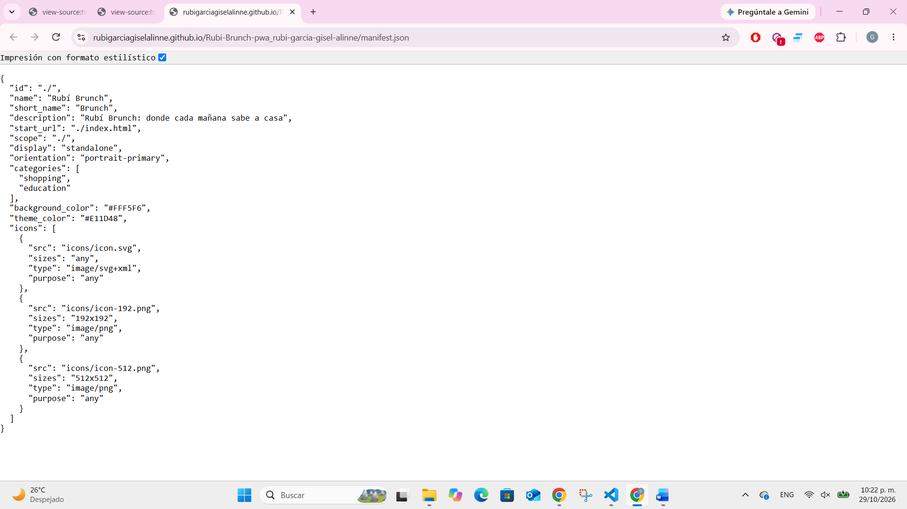
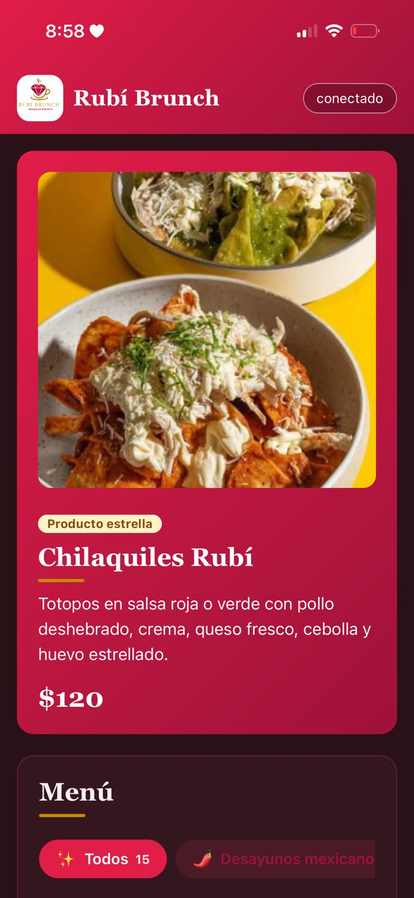

# Rubí Brunch — PWA de ventas

| Dato | Valor |
|---|---|
| **Alumno** | RUBI GARCIA GISEL ALINNE |
| **Grupo** | ING10-1 |
| **Negocio · giro** | Rubí Brunch · Desayunos y brunch · Restaurante de desayunos y brunch: platillos mexicanos de mañana, opciones dulces y bebidas, hasta las 2 de la tarde. |
| **URL del repositorio** | https://github.com/RubiGarciaGiselAlinne/Rubi-Brunch-pwa_rubi-garcia-gisel-alinne |
| **URL de GitHub Pages** | https://rubigarciagiselalinne.github.io/Rubi-Brunch-pwa_rubi-garcia-gisel-alinne/ |

## Historial de avances

| Avance | Hash del commit entregado | Fecha |
|---|---|---|
| 1 | 3b7528b | 11/10/2026 |
| 2 | 648658a | 18/10/2026 |
| 3 | d5515ef | 25/10/2026 |
| 4 | (se escribe en el reporte PDF) | 01/11/2026 |

## Comparación SSR vs CSR

### SSR (Django): los productos llegan escritos en el HTML

### CSR (JavaScript): el div del catálogo llega vacío

## Funciones PWA (avance 3)

### index.html: manifest y registro del Service Worker activos

### sw.js: Workbox precachea el catálogo y las fotos

## Versión publicada (avance 4)

### index.html en GitHub Pages

### manifest.json en GitHub Pages

### Mi app instalada en el celular

### Instalacion 
Guía de instalación y uso de Rubí Brunch

Rubí Brunch es una aplicación web progresiva (PWA): se abre desde el navegador, se instala en el teléfono o la computadora como una app más y sigue funcionando, aunque se pierda el internet.

Dirección de la app: https://rubigarciagiselalinne.github.io/Rubi-Brunch-pwa_rubi-garcia-gisel-alinne/

1. ¿Qué necesitas?
Un teléfono o una computadora con internet para la primera visita.
Android: Google Chrome.
iPhone o iPad: Safari (la instalación solo se puede hacer desde Safari).
Computadora: Google Chrome o Microsoft Edge.
2. ¿Cómo abrirla?
Abre el navegador de tu dispositivo.
Escribe la dirección de la app (o ábrela desde el enlace del repositorio).
Espera a que cargue completa: verás el encabezado rubí con el nombre "Rubí Brunch", el platillo especial y el menú con sus fotos.

Importante: la primera vez debes abrirla con internet y esperar unos segundos. En ese momento la app guarda sus archivos en el dispositivo para poder funcionar sin conexión.

3. ¿Cómo instalarla?
En Android (Chrome)
Abre la app en Chrome.
Toca los tres puntos (⋮) de la esquina superior derecha.
Elige Instalar app (en algunos teléfonos dice Agregar a la pantalla principal).
Confirma con Instalar.
El ícono de Rubí Brunch aparecerá en tu pantalla de inicio.
En iPhone o iPad (Safari)
Abre la app en Safari.
Toca el botón Compartir (el cuadro con una flecha hacia arriba, en la barra inferior).
Baja en el menú y toca Agregar a pantalla de inicio.
Toca Agregar, arriba a la derecha.
El ícono aparecerá en tu pantalla de inicio.
En computadora (Chrome o Edge)
Abre la app en el navegador.
Busca el ícono de instalar al final de la barra de direcciones (una pantalla con una flecha hacia abajo).
Haz clic en él y elige Instalar.
Se abrirá una ventana propia y se creará un acceso directo.

Si no ves la opción de instalar, recarga la página, espera unos segundos y revisa que estés usando la dirección que empieza con https://.

4. ¿Cómo usarla?

Abre la app desde el ícono de tu pantalla de inicio. Se abre sin la barra de direcciones, como una app normal.

Ver el menú
Arriba aparece el platillo especial, los Chilaquiles Rubí, con su descripción y precio.
Más abajo está el Menú con los 15 productos agrupados en tres categorías: Desayunos mexicanos, Brunch dulce y ligero y Bebidas.
Para ver solo una categoría, toca su botón en la barra de filtros (desliza hacia los lados para verlos todos). Toca Todos para volver a ver el menú completo.
Hacer un pedido
Toca Agregar en el producto que quieras.
Aparece un aviso flotante en la parte de abajo con el nombre del producto agregado. Si activaste las notificaciones, también recibirás un aviso del sistema.
En la sección Carrito verás tus productos. Usa los botones − y + para cambiar la cantidad, o Quitar para eliminar un producto.
El Total se actualiza automáticamente.
Toca Sincronizar carrito para enviar el carrito. Con internet aparece el aviso Carrito sincronizado. Sin internet, el aviso indica que se sincronizará cuando vuelva la conexión.

Tu carrito se guarda en el dispositivo, así que no se pierde, aunque cierres la app.

Activar las notificaciones
Baja a la sección Notificaciones de ofertas.
Toca Activar notificaciones.
Cuando el dispositivo pregunte, elige Permitir.
Verás una notificación de confirmación y el mensaje Notificaciones activadas.

En iPhone las notificaciones solo funcionan con la app instalada en la pantalla de inicio y con iOS 16.4 o más reciente.

Ver la distancia a la sucursal
Baja a la sección Distancia a la sucursal.
Toca Usar mi ubicación y elige Permitir cuando el dispositivo lo pida.
La app dibuja en un mapa la ruta desde donde estás hasta la sucursal de Rubí Brunch, y muestra los kilómetros y el tiempo aproximado en auto.
Toca Abrir en el mapa para ver la ruta completa en otra pestaña.

El mapa necesita internet. Sin conexión no se dibuja.

Usarla sin internet
Cuando se pierde la conexión, el indicador de arriba cambia a sin conexión y aparece un aviso flotante.
Aun así, puedes ver el menú con sus fotos, usar los filtros y manejar tu carrito.
Cuando vuelve el internet, el aviso cambia a Conexión restablecida.
5. ¿Cómo desinstalarla?
Android: mantén presionado el ícono, elige Desinstalar (o Información de la app → Desinstalar).
iPhone: mantén presionado el ícono y elige Eliminar app.
Computadora: abre la app, haz clic en los tres puntos de su ventana y elige Desinstalar.
